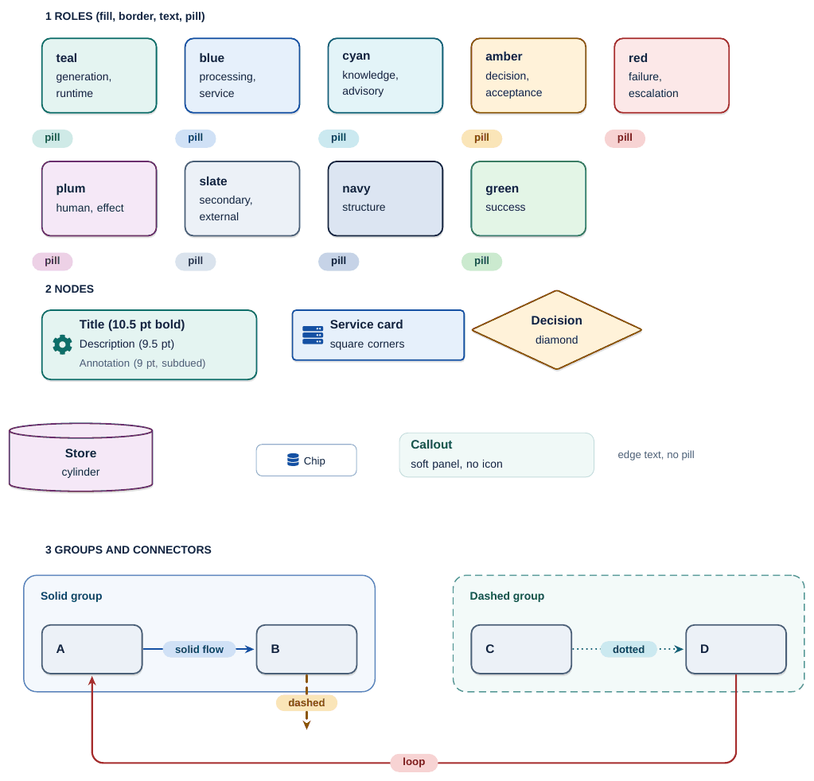

# Diagram style guide (TikZ)

The publication style for the book's figures. Everything here is implemented once in `latex/styles/professional-diagrams.sty`; a figure source is `assets/diagrams/src/<id>.tikz.tex`, registered in `config/diagrams.json` with that path as `source`. `make diagrams` compiles it with XeLaTeX to a cropped vector PDF (embedded by the book) and rasterises the PNG (embedded by the DOCX edition) from that PDF. All constructs on one sheet: `diagram-style-sheet.png` (source `diagram-style-sheet.tikz.tex`).



## Principles

1. **Modernize, never reinterpret.** A figure keeps every node, label, edge, direction, group and annotation of the original. Layout may change; logical structure may not. Every source file carries a mapping comment, original element to restyled element. Anything the source does not say is not drawn (no step numbers, no invented bullets).
2. **Draw at final size.** The canvas is about 7 in wide (the book's text width is 7.06 in), so 9 pt in the source is 9 pt on the page. Never `\resizebox` or `scale`. One TikZ unit is one point (`x=1pt,y=1pt`), so a 500-unit canvas is about 6.9 in. Height at most about 8.3 in.
3. **Meaning is never colour alone.** Shape (diamond = decision, cylinder = store, square corners = service), line style (solid flow, dashed control, dotted evidence) and the words carry it; colour adds. All figures must read in greyscale.
4. **One role, one look.** A role is a pastel fill, a darker same-hue border, and dark text. Do not invent colours in a figure.

## Palette

| Role | Fill | Border / icon / arrow | Text | Pill | Meaning in the book |
|---|---|---|---|---|---|
| `teal` | `#E4F4F1` | `#0D6E69` | `#084B47` | `#CDEAE6` | generation, agent runtime, iteration |
| `blue` | `#E6F0FB` | `#1450A3` | `#0E3A78` | `#D0E1F6` | processing, validation, platform services |
| `cyan` | `#E3F4F8` | `#0B6076` | `#084357` | `#CBE9F0` | knowledge, evidence, advisory reasoning |
| `amber` | `#FFF2D9` | `#8A5600` | `#613C00` | `#FAE5B8` | decisions, acceptance, gates |
| `red` | `#FCE8E8` | `#A62C2C` | `#7A1D1D` | `#F7D3D3` | failure, refusal, escalation, intervention |
| `plum` | `#F5E8F7` | `#6A2E6E` | `#4A1F4D` | `#EBD2EE` | human, specialised reasoning, committed effect |
| `slate` | `#ECF1F7` | `#4A6078` | `#2F4256` | `#DAE3ED` | secondary, external, neutral |
| `navy` | `#DCE5F2` | `#12233F` | `#12233F` | `#C6D3E8` | structure, headers |
| `green` | `#E3F5E6` | `#2D7A3A` | `#1D5227` | `#CBEACF` | success, completion (defined, unused so far) |

Body text is `dg-ink` `#12233F`; subdued annotation `dg-note` `#4A5F76`; default connector `dg-edge` `#3A4F6B`. Measured contrast: ink on every fill 12.4 to 14.2:1; annotation on every fill 5.2 to 5.9:1; role text on its pill 7.1 to 10.4:1; border on its fill 4.7 to 12.4:1. The fills, borders and hues are the book's existing house palette (`styles/DESIGN-SYSTEM.md` section 10a), so a figure that was teal in Graphviz stays teal. The first seven rows are the original roles; `navy` and `green` are the only additions.

## Type scale (Liberation Sans, the book's family)

| Use | Size / leading | Weight | Colour |
|---|---|---|---|
| Card title | 10.5 / 12.6 pt | bold | ink |
| Card description | 9.5 / 11.6 pt | regular | ink |
| Annotation, edge text | 9 / 11 pt | regular | note |
| Pill / edge label | 9 / 10.8 pt | bold | role text |
| Group label | 9.5 / 11.4 pt | bold | role text |

Nothing is set below 9 pt. A second line inside a pill is set regular. Labels are never hyphenated.

## Card anatomy

```latex
\node[dg card=teal, icon=cog, text width=150pt] (gate) at (258,-285)
  {\dgcontent{Title}{Description}{Annotation}};
```

- `dg card=<role>`: rounded rectangle, 6 pt radius, 1 pt border, 10 pt x 7 pt padding, minimum height 34 pt, faint offset shadow (0.12 opacity, 1.6 pt; prints as a hairline, vanishes in greyscale). `square` tightens the corners (service boxes). `\dgshadowfalse` in the preamble removes every shadow.
- `\dgcontent{title}{description}{annotation}`: any argument may be empty; a title-only card is common.
- `icon=<fontawesome5 name>`: a 14 pt glyph in the role's border colour, vertically centred at the left; text is indented 2.1 em to clear it. Use an icon only where it names the concept (cog = engine, trophy = accepted, users = human). Icons so far: `file-code`, `clipboard-check`, `database`, `file-alt`, `calculator`, `shield-alt`, `user-friends`, `cog`, `trophy`, `users`, `pen`, `id-badge`, `clipboard-list`, `balance-scale`, `robot`, `link`, `concierge-bell`, `gavel`, `server`. Cards without a natural icon go without (the effect-lifecycle states have none).
- `dg decision=<role>`: diamond, `minimum width` about 170 pt and `minimum height` 62 to 66 pt for a two-line label. `dg store=<role>`: cylinder.
- `chip=<role>`: small white tag with a role-coloured hairline, 9 pt, for words the source already lists (the four checks).
- `callout=<role>`: borderless soft panel for a free annotation; `edge text`: unframed 9 pt note beside a connector.

## Connectors

| Style | Use |
|---|---|
| `flow in=<role>` | solid flow; colour = meaning of the path (amber accepted, red escalated, teal rejected/revise loop) |
| `dashed flow, draw=dg-<role>-line` | control, optional or skipped path (the source's dashed edges) |
| `dotted flow, draw=dg-<role>-line` | evidence or reference (the source's dotted edges) |
| `turn` | adds 8 pt rounded corners to an orthogonal path (`-|`, `|-`) |

All connectors: 1.2 pt, round caps, `-{Stealth[6.5pt x 5.5pt]}`. Rules: orthogonal with rounded corners by default; a gentle `to[out=..,in=..]` curve where a straight run would cut across cards; the loop that closes a cycle goes around the outside with a 16 pt radius (`rounded corners=16pt`); arrows keep the original direction, always. Never route a line through a card or a label; if two lines would share a segment, offset their anchors (`[xshift=26pt]rev.north`). The arrowhead needs 10 pt of clear run: do not put a pill within 10 pt of an arrow tip.

## Pills (edge labels)

`\node[pill=<role>]` on a path (`-- node[pill=amber]{Accepted} (b)`): a capsule in the role's pill tint, 9 pt bold role-coloured text, 8 pt side padding. One or two lines (`Escalated\\{\fontsize{9}{10}\selectfont\mdseries cap · no progress}`: bold word plus a regular subtitle). Use the role of the path, not of the target. Place a pill on the longest straight segment, at least one pill height clear of corners. A pill placed on a rounded path needs `sharp corners` (already in the style) or it inherits the path's rounding.

## Groups

`\dggroup{name}{role}{Title}{(n1)(n2)(n3)}` draws a container on the `dgback` layer around existing nodes with a title in the top band; `\dggroupbelow` puts the title at the bottom (use it when connectors enter from above, as in `governance-model`). `\dggroup[dash pattern=on 5pt off 3pt]{...}` gives a dashed boundary (trust boundary, plane). Fill is 45 percent of the role fill, border 70 percent of the role border, radius 9 pt, padding 12 pt plus a 22 pt title band.

## Spacing constants

Card padding 10 / 7 pt; card gap in a row 20 to 32 pt; row pitch 66 to 90 pt (a connector needs about 30 pt of clear run to carry a one-line pill); group padding 12 pt; canvas border 6 pt (`standalone`). Coordinates are in points; keep a column grid (for example centres at 68 / 245 / 410 for three columns of 130 pt cards in a 500 pt canvas).

## Do / don't

| Do | Don't |
|---|---|
| Keep the original's labels, adding only capitalisation and punctuation | Add step numbers, bullets or captions the source lacks |
| Reuse a role for a concept already coloured that way elsewhere | Add a hue |
| Put the mapping comment (original element to restyled element) at the top of the source | Change an arrow direction to make the layout easier |
| Draw at 7 in wide and let the validator check it | `\resizebox` or `scale` to fit |
| Offset anchors so lines do not overlap | Run a connector through a card or a pill |
| Raise a technical doubt with the maintainer or in the pull request | Silently fix it in the figure |

## How to add or convert a diagram

1. Read the original source and the chapter text. List its nodes and edges (`dot -Tplain` gives exact counts). Write the mapping comment first.
2. Copy `assets/diagrams/src/pattern-reflection.tikz.tex` (flow) or `governance-model.tikz.tex` (groups) as a starting point. Place cards by coordinates on a column grid; draw edges after.
3. `make diagrams` (or `python tools/render_diagrams.py --only <id>`), then open `assets/diagrams/<id>.png`. Compare against the original side by side; check every edge and label; check greyscale.
4. Register: set `source` to `assets/diagrams/src/<id>.tikz.tex` in `config/diagrams.json` (the renderer writes the new checksum), and delete the old `.gv`/`.mmd` (history keeps it).
5. `make assemble build references latex latex-validate validate`, then `make pdf` and inspect the figure's page.
6. Fast loop while drawing: `TEXINPUTS=latex/styles: xelatex -output-directory=/tmp assets/diagrams/src/<id>.tikz.tex` from the repository root, then `pdftoppm -r 150 -png`.
